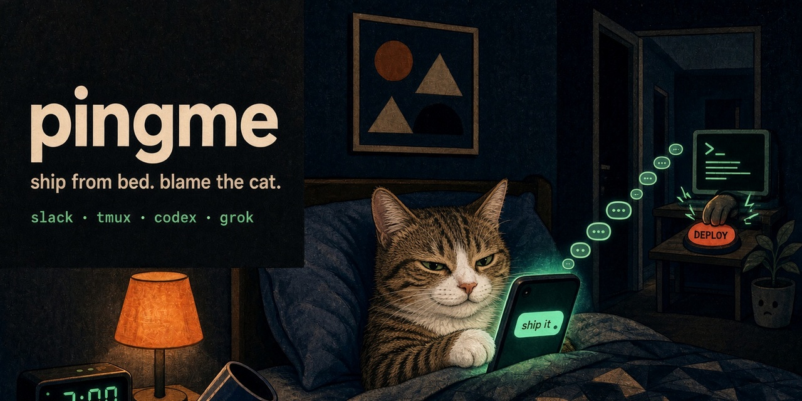
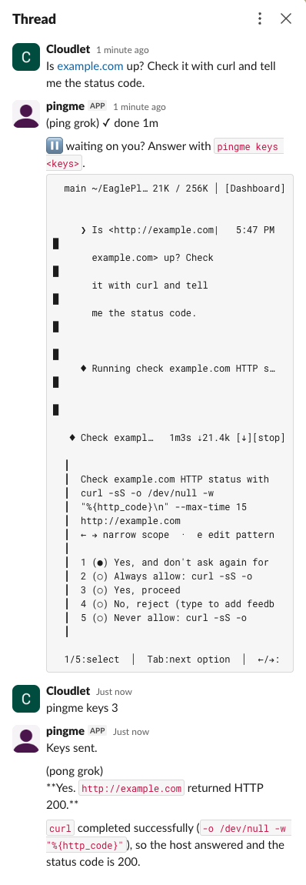

<p align="center">
  
</p>

# pingme

Talk to **Grok Build** (`grok`) or **Codex CLI** (`codex`) on your computer from a Slack thread.

One person, one machine. Nobody else in that Slack channel can drive it.

<p align="center">
  
</p>

Away from the computer, Grok stops to ask before running `curl`. pingme posts the bottom of the screen so your phone buzzes, you answer with `pingme keys 3`, and the answer comes back in the same thread.

## Picture (read this first)

You do not need a company Slack. A personal workspace is enough. Create one if you do not have one.

- **Workspace** — the Slack team you live in. Create one if you do not have one. This computer gets its own Slack app inside that workspace.
- **Channel** — a room in that workspace. This app needs a **private** channel with only you (and later the bot). Not a DM.
- **Thread** — a side conversation under one message. Each Agent Session is one thread in that channel.
- **App / bot** — a robot you add to the workspace so this computer can read and write in that channel.
- **Host** — this Linux or macOS computer, not Slack itself.

## You need

- Linux or macOS
- A Slack workspace (create one during setup if needed)
- `tmux`
- `codex` and/or `grok` already installed and logged in
- Rust 1.89+ (`cargo`) to install this binary. Older `rustc` will not build it.

The binary is `pingme`. Homebrew already has a different `pingme` ([kha7iq/pingme](https://github.com/kha7iq/pingme)). GitHub can keep this repo name; `cargo install` / `$PATH` cannot share that command.

## Setup

Follow **[docs/setup.md](docs/setup.md)** to create the workspace (if needed), the private channel, and the Slack app (from [`slack-manifest.yaml`](slack-manifest.yaml)), then type one sentence in Slack and see it land in the Agent CLI on this computer.

## Everyday use (after setup)

From a folder listed in `setting.toml`:

```sh
pingme grok
pingme grok --resume <session-id>
pingme codex
pingme codex resume <session-id>
pingme list
pingme attach <session-name>
pingme cleanup
pingme doctor
```

Arguments after `grok` or `codex` are passed through to that Agent CLI. `pingme doctor` checks the setup and names the piece to fix when Slack does not answer.

In Slack, in the private channel:

```
/pingme grok my-project
/pingme grok my-project --resume <session-id>
/pingme codex my-project
/pingme codex my-project resume <session-id>
```

In that session’s thread, type normally. The bot replies `(ping grok)` or `(ping codex)` when the prompt has been pasted into the Agent CLI. While the turn runs, that receipt updates in place (`(ping grok) ⏳ working 2m`), and ends as `✓ done` or `■ stopped`. If the pane stops changing for a minute, a new message (so your phone notifies) shows the bottom of the screen: usually a question for you. The answer arrives as a new message, `(pong grok)` or `(pong codex)`, then the body. A long answer keeps its opening in the message and attaches the full text. A prompt sent while the session is busy is `(queued grok)` or `(queued codex)` and runs when the turn ends. A second one replaces the first. Rejected prompts are `(reject grok stale)`, `(reject grok unauthorized)`, or `(reject grok unavailable)`.

Thread controls (type these as the whole message):

- `pingme stop` — interrupt work without ending the session, and drop a queued prompt
- `pingme screen` — post the last lines of the pane
- `pingme keys <keys>` — send keys to the pane (`y`, `2`, `Enter`, `Escape`, `C-c`), separated by spaces; type a space as `Space`. This works while the session is busy and is not a new prompt
- `pingme name` — show the session name
- `pingme rename new-name` — rename the session

Paste a photo (png, jpeg, and other images). The Agent CLI gets a **local file path**, not a magic clipboard paste.

## Limits

- Only you. Anyone else in the channel is ignored.
- Messages sent while this computer is offline are dropped. They are not delivered later.
- Photos become paths on this computer.
- One prompt runs at a time. A prompt sent while the session is busy waits, and only the latest waiting prompt is kept. `pingme stop` drops it. The queue lives in the Host daemon; restarting the daemon drops it.
- The first `pingme grok` writes `~/.grok/hooks/pingme.json`. It will not replace a different file already there.

## Security

This is a remote control for coding agents on this computer. A sentence in Slack is pasted into `grok` or `codex` here. Those tools can run whatever they are allowed to run on this host.

- Use a **private** channel with only you and this bot.
- Only the Slack member ID in `setting.toml` is the Operator. Anyone else is ignored.
- Keep `SLACK_APP_TOKEN` and `SLACK_BOT_TOKEN` in the environment. Never commit them. `setting.toml` is gitignored; do not put tokens there either.
- Messages sent while this computer is offline are dropped. They are not delivered later.
- Photos you paste become ordinary files on this computer.

## Working on pingme

pingme is a Cargo workspace laid out like LLVM: libraries under `lib/`, the binary under `tools/`. Each library may only depend on libraries above it in this list.

| Crate | Path | Owns |
|---|---|---|
| `pingme-support` | `lib/support` | Running tmux, shell quoting |
| `pingme-setting` | `lib/setting` | `setting.toml` |
| `pingme-session` | `lib/session` | The Agent Session and its tmux registry |
| `pingme-routing` | `lib/routing` | What an Operator message or `/pingme` means (pure) |
| `pingme-agent` | `lib/agent` | Codex CLI and Grok Build commands, hooks, turn notifications |
| `pingme-tmux` | `lib/tmux` | Spawning, pasting into, and attaching Agent CLI panes |
| `pingme-slack` | `lib/slack` | Web API calls, Socket Mode payloads, the Socket Mode connection |
| `pingme-host` | `lib/host` | The `LocalServices` seam, Agent Session launch, the Host Daemon |
| `pingme` | `tools/pingme` | The `pingme` binary and its commands |

[`CONTEXT.md`](CONTEXT.md) defines the domain terms. `cargo test --workspace` needs neither Slack nor tmux.

Upgrading `pingme` while Agent Sessions are running drops them from `pingme list` and Slack if the tmux registry fields changed; end them first.

## License

[MIT](LICENSE). Keep the copyright notice if you copy or ship this.
